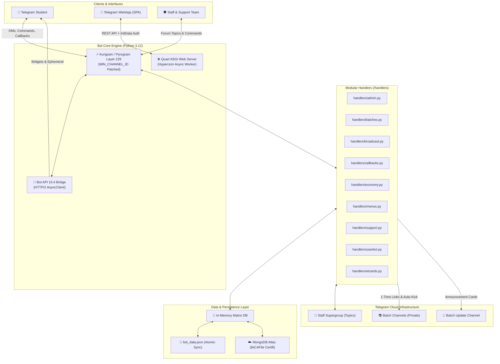

<div align="center">

# ⚡ H4R Telegram Bot & Student Education Ecosystem
### *Enterprise-Grade Telegram Bot, WebApp Portal & Automated Batch Management Engine*

[](https://python.org)
[-0088cc?style=for-the-badge&logo=telegram&logoColor=white)](https://core.telegram.org/bots/api)
[](https://github.com/Telegram-Kurigram/Kurigram)
[](https://pgjones.gitlab.io/quart/)
[](https://mongodb.com)
[](https://docker.com)
[](https://huggingface.co/spaces)

<br/>

**A mission-critical, production-ready Telegram Bot & Student Community Ecosystem. Engineered with a Telegram Bot API 10.4 Hybrid Bridge, Telegram WebApp (TWA) Student Portal, Multi-Tier Batch Provisioning with 1-Time Expiring Links, Bidirectional Forum Support Tickets with Auto-Pinned Profiles, Userbot Disaster Recovery, and Real-Time Anti-Leech Protection.**

<br/>

[🌟 Features](#-core-features) • [🏛️ System Architecture](#-system-architecture) • [📂 Project Structure](#-project-structure) • [📱 Student WebApp](#-student-webapp-portal) • [🚀 Quick Start](#-quick-start--installation) • [☁️ Deployment](#-deployment-options) • [📖 Commands & Manual](#-commands--manual) • [🔌 REST APIs](#-rest-api-endpoints) • [⚙️ Configuration](#-environment-variables)

---

</div>

## 🌟 Core Features

```
┌────────────────────────────────────────────────────────────────────────────────────────┐
│                                 H4R BOT CORE ECOSYSTEM                                 │
├─────────────────────┬─────────────────────┬─────────────────────┬──────────────────────┤
│ 🚀 Bot API 10.4     │ 🎫 Forum Support    │ 🔐 Batch Management │ 🤖 Userbot Suite     │
│ • In-Chat Widgets   │ • Auto-Pinned Info  │ • 1-Time Auto-Links │ • Batch Restorer     │
│ • Ephemeral Answers │ • 2-Way Live Sync   │ • 3-Hour Auto-Demo  │ • Super Forwarder    │
│ • 64B Safe Buttons  │ • In-Topic Commands │ • Demand Console    │ • Caption Editor     │
│ • Giveaway Tickers  │ • Audit File (.txt) │ • Auto-Approval     │ • Anti-Leech Cleaner │
└─────────────────────┴─────────────────────┴─────────────────────┴──────────────────────┘
```

### 1. 🚀 Telegram Bot API 10.4 Hybrid Bridge (`bot_api_bridge.py`)
Runs an asynchronous HTTP/2 client (`httpx.AsyncClient`) alongside Pyrogram/Kurigram MTProto for native Bot API 10.4 features:
* **Interactive In-Chat Widgets (`sendWidget`, `editMessageWidgetData`):** Delivers rich HTML interactive cards and mini-apps with `protected_content` (anti-piracy forward prevention).
* **Ephemeral Messages:** Zero-clutter ephemeral replies and alerts attached to `callback_query_id` via `ephemeral_message_parameters`.
* **64-Byte Safe Callback Protocol:** Callback payloads strictly enforce the `<64 byte` Telegram protocol limit using indexed state routing, preventing `BUTTON_DATA_INVALID` errors even for extra-long batch titles.
* **Interactive Giveaway Cards:** Live giveaway tickets with animated Unicode progress bars (`[██████░░░░] 60%`), real-time slot counters, and instant claimer audit modals.
* **Batch Demands Console:**
  * Clean single-button-per-row layout with full student demand counters.
  * Direct 1-tap fulfillment via Bot Channel links.
  * Dedicated broadcast tool to message all requesters when a course goes live.
  * 1-tap individual or bulk demand cleanup.

---

### 2. 🎫 Forum Support Ticket System & Auto-Pinned Profiles
* **Bidirectional 2-Way Sync:** Automatically converts student private DMs into dedicated Telegram Forum Topics inside a private Staff Supergroup.
* **Auto-Pinned Profile Card:** On new ticket creation, the bot automatically formats and pins an executive student dossier showing:
  * Full Name, Username, and Numeric Telegram ID.
  * Study Coin Balance & Lifetime Referral Count.
  * Active Demo Batches & Permanent Channel Memberships.
* **In-Topic Admin Commands:** Staff can manage students directly from within their forum topic:
  * `/info` — View real-time student profile snapshot.
  * `/file` / `/txt` — Instantly generate and upload a complete `.txt` audit report.
  * `/demo <link> [hours]` — Grant temporary trial access (default: 3h) with auto-approval.
  * `/per <link>` — Grant lifetime permanent channel access with auto-approval.
  * `/extend [hours]` — Extend active demo duration.
  * `/giftcoin <amount>` — Credit bonus study coins directly to the student.
* **Reaction & Deletion Mirroring:** Staff reactions and message deletions in the topic automatically mirror in the student's DM in real time.

---

### 3. 🔐 Multi-Tier Batch Provisioning & Access Lifecycle
* **Three Dedicated Access Tiers:**
  * 🆓 **Free Batches:** Generates unique, 1-time expiring join links (60-second TTL) to prevent unauthorized distribution. Includes a 1-coin unlock mechanism after 3 free batches.
  * 💵 **Paid Batches:** Supports dynamic pricing, QR screenshot proof submissions, and an instant approval workflow.
  * ✨ **Special Batches:** Unlocked exclusively through referral coins.
* **Automated 3-Hour Demo Lifecycle:**
  * Background cron scheduler monitors trial expiry timestamps.
  * Automatically removes students from channels when trials expire and logs audit entries to the audit channel.
* **Announcement Broadcast Engine:**
  * Downloads and caches batch channel avatars.
  * Publishes high-conversion announcement cards with **Richpyro Primary** and **Success** buttons.
  * Automatically notifies all waiting requesters when their requested batch goes live.

---

### 4. 📱 Student WebApp Portal (`/webapp`, `/app`)
A fast, mobile-first single-page application built on top of the Telegram WebApp SDK (`Telegram.WebApp`):
* **Student Hub:** Verified Telegram profile, wallet coin balance, referral stats, and direct batch study access.
* **🎯 Competitive Exam Radar:** Real-time tracking of active national exams (UPSC, SSC, RRB, Banking, Defence, State PSCs) with eligibility, last dates, and direct links.
* **⏳ 2026 Exam Countdown Clocks:** Live countdown timers (Days : Hours : Mins : Secs) to target exam dates.
* **📰 Daily Current Affairs:** Curated high-yield updates across National Affairs, Science, Defence, and Economy.
* **📝 Multi-Subject Mock Test Arena:** Real-time exam timer, TCS-style marking (+2.0 positive, -0.50 negative penalty), and instant accuracy breakdown.
* **⏱️ Pomodoro Study Timer & Streaks:** Tracks study minutes, completed sessions, and gamified daily streaks.
* **🛡️ Role-Based Maintenance Guard:** Regular users see an animated maintenance portal, while Owner, Admins, and Whitelisted Testers bypass it seamlessly.

---

### 5. 🤖 Userbot Content Automation Suite & Disaster Recovery
* **📦 Automated Batch Restorer (`/restorebatches` / `restore_batches.py`):**
  * Recovers batch channels from JSON/MongoDB backups.
  * Userbot joins private channels, adds the bot, promotes it to Administrator, generates invite links, and restores category metadata.
  * Non-destructive operation that preserves existing database records.
* **⚡ Super Forwarder:** High-speed bulk media, lecture, and file forwarding with automatic flood-wait protection.
* **✏️ Advanced Caption Editor:** Bulk modifies channel message captions within a message ID range (`min_id` to `max_id`) using regex, prefix, and suffix rules without re-uploading media.
* **🛡️ Anti-Leech Cleaner:** Periodic background scanner kicks users who leave the mandatory force-sub channel.

---

## 🏛️ System Architecture



---

## 📂 Project Structure

```
botupdate/
├── bot.py                   # Main entry point (Pyrogram MTProto client & lifecycle)
├── config.py                # Environment configuration, database engine & helpers
├── app.py                   # Quart ASGI web server & WebApp REST APIs
├── bot_api_bridge.py        # Bot API 10.4 hybrid bridge (HTTP/2 async client)
├── restore_batches.py       # Standalone Userbot disaster recovery utility
├── requirements.txt         # Production Python dependencies
├── Dockerfile               # Production Docker container build
├── bot_data.json            # Local atomic JSON database store
├── handlers/                # Modular Bot Handlers Package
│   ├── __init__.py          # Package initializer & backward-compatible exports
│   ├── admin.py             # Admin commands, testers, ban system & maintenance
│   ├── batches.py           # Batch creation, demo/perm approvals & link resolution
│   ├── broadcast.py         # Super broadcast engine & channel announcement cards
│   ├── callbacks.py         # 64-byte safe callback router & interactive menus
│   ├── common.py            # Shared utility functions, permissions & state stores
│   ├── economy.py           # Coins gifting, referrals & promo vouchers
│   ├── menus.py             # Dynamic UI menus, student dashboard & catalogs
│   ├── support.py           # 2-way forum support tickets & topic commands
│   ├── userbot.py           # Userbot login flow (phone/OTP/2FA) & forwarding
│   └── wizards.py           # Step-by-step interactive configuration wizards
└── templates/               # WebApp HTML & SPA dashboard templates
```

---

## ⚙️ Environment Variables

Configure these variables in your `.env` file or cloud dashboard:

| Variable | Required | Default | Description |
|---|:---:|:---:|---|
| `TELEGRAM_BOT_TOKEN` | **Yes** | — | Bot token obtained from [@BotFather](https://t.me/BotFather) |
| `OWNER_ID` | **Yes** | `0` | Numeric Telegram User ID of the primary owner |
| `API_ID` | Conditional | `0` | Telegram API ID from [my.telegram.org](https://my.telegram.org) (for Userbot/Restorer) |
| `API_HASH` | Conditional | `""` | Telegram API Hash from [my.telegram.org](https://my.telegram.org) |
| `MANDATORY_CHANNEL_ID` | **Yes** | `0` | Force-sub channel ID (e.g. `-1001234567890`) |
| `MANDATORY_CHANNEL_LINK` | **Yes** | `""` | Invite link for the mandatory force-sub channel |
| `SUPPORT_GROUP_ID` | **Yes** | `0` | Supergroup ID with **Topics (Forums)** enabled |
| `BATCH_UPDATE_CHANNEL_ID` | No | `-1004304703943` | Channel ID for live batch announcements |
| `BATCH_UPDATE_CHANNEL_LINK`| No | `""` | Invite link to the Batch Update Channel |
| `LOG_CHANNEL_ID` | No | `0` | Channel ID for audit trails, demo expiries, and alerts |
| `MONGO_URL` | No | `None` | MongoDB Atlas URI for persistent cloud database sync |
| `DATA_FILE` | No | `bot_data.json` | Path to the local JSON database file |
| `PORT` | No | `7860` | Web server port (Default: `7860` for Hugging Face) |
| `WEB_APP_URL` | No | Auto | Public URL of the WebApp (e.g. `https://your-space.hf.space`) |
| `WEB_PASSWORD` | No | `OWNER_ID` | Password to access `/owner` and `/admin` web dashboards |
| `SESSION_STRING` | No | `""` | Pyrogram String Session for Userbot features |

> [!IMPORTANT]
> Channel and Group IDs must be numeric integers starting with `-100` (e.g., `-1001928374650`).

---

## 🚀 Quick Start & Installation

### Option 1: Native Python Setup

1. **Clone the repository:**
   ```bash
   git clone https://github.com/itsh4ro5/botupdate.git
   cd botupdate
   ```

2. **Set up a virtual environment:**
   ```bash
   python -m venv venv

   # Linux / macOS:
   source venv/bin/activate

   # Windows PowerShell:
   venv\Scripts\Activate.ps1
   ```

3. **Install dependencies:**
   ```bash
   pip install --upgrade pip
   pip install -r requirements.txt
   ```

4. **Configure environment:**
   ```bash
   cp .env.example .env
   # Edit .env with your credentials
   ```

5. **Start the bot engine:**
   ```bash
   python bot.py
   ```

---

### Option 2: Docker Container

```bash
# Build the Docker image
docker build -t h4r-telegram-bot .

# Run the container
docker run -d \
  --name h4r-bot \
  --restart always \
  -p 7860:7860 \
  --env-file .env \
  -v $(pwd)/data:/app/data \
  h4r-telegram-bot
```

---

## ☁️ Deployment Options

<details>
<summary><b>1. Deploying to Hugging Face Spaces (Recommended)</b></summary>

This repository includes native Hugging Face Spaces Docker headers.
1. Create a new Space on [Hugging Face](https://huggingface.co/new-space).
2. Choose **Docker** as the Space SDK (Blank template).
3. Connect your GitHub repository or push directly to the HF Space git remote.
4. Go to **Settings > Variables and secrets** in your Space:
   * Add `TELEGRAM_BOT_TOKEN`, `OWNER_ID`, `MANDATORY_CHANNEL_ID`, `MANDATORY_CHANNEL_LINK`, `SUPPORT_GROUP_ID`, `MONGO_URL`, etc.
5. The container boots automatically and opens the health endpoint on port `7860`.
</details>

<details>
<summary><b>2. Deploying to Render / Koyeb / Railway</b></summary>

1. Connect your GitHub repository to **Render** or **Koyeb**.
2. Create a new **Web Service**.
3. Set the Environment to **Docker** (or Python 3.10+).
4. If using native Python:
   * Build Command: `pip install -r requirements.txt`
   * Start Command: `python bot.py`
5. Supply all environment variables under the **Environment** tab.
6. *(Recommended)* Add a persistent disk mounted at `/app/data` and set `DATA_FILE=/app/data/bot_data.json`.
</details>

<details>
<summary><b>3. Deploying to Ubuntu VPS with Systemd</b></summary>

Create a systemd service file `/etc/systemd/system/h4rbot.service`:
```ini
[Unit]
Description=H4R Telegram Bot & Web Ecosystem
After=network.target

[Service]
Type=simple
User=root
WorkingDirectory=/root/botupdate
ExecStart=/root/botupdate/venv/bin/python bot.py
Restart=always
RestartSec=5
EnvironmentFile=/root/botupdate/.env

[Install]
WantedBy=multi-user.target
```
Enable and start the service:
```bash
sudo systemctl daemon-reload
sudo systemctl enable h4rbot
sudo systemctl start h4rbot
sudo systemctl status h4rbot
```
</details>

---

## 📖 Commands & Manual

### 👑 Owner Terminal Commands
| Command | Arguments | Description |
|---|---|---|
| `/owner` | None | Opens the interactive Master Terminal with toggles & system stats |
| `/addadmin` | `<user_id>` | Dynamically promotes a user to Admin |
| `/deladmin` | `<user_id>` | Demotes an Admin to standard user |
| `/addtester` | `<user_id>` | Whitelists a user to bypass maintenance mode |
| `/deltester` | `<user_id>` | Removes a user from tester whitelist |
| `/testers` | None | Lists all active whitelisted testers |
| `/backup` | None | Instant export & document download of `bot_data.json` |
| `/sync` | None | Forces immediate synchronization with MongoDB Atlas |
| `/restorebatches`| None (reply to file)| Launches Userbot automated batch recovery from backup JSON |
| `/allusers` | None | Generates a complete registered user dump/CSV |
| `/genvoucher` | `<CODE> <COINS> <USES>`| Mints custom study coin gift vouchers |
| `/vouchers` | None | Displays active promo vouchers (with auto-file fallback) |
| `/setprice` | `<batch_id> <price>`| Sets or updates pricing for paid batches |
| `/setwelcome` | `<batch_id> <text>` | Configures custom welcome DM for batch joiners |
| `/setrequestnote`| `<text>` | Sets dynamic acknowledgement note for batch demands |
| `/maintenance` | None | Toggles global bot maintenance mode |
| `/ban` / `/unban` | `<user_id>` | Blacklists or whitelists a user from the bot |
| `/resetuser` | `<user_id>` | Clears a user's join history and trial demo records |

---

### 🛡️ Admin Commands
| Command | Arguments | Description |
|---|---|---|
| `/admin` | None | Opens Admin Dashboard & Approvals Center |
| `/addbatch` | None | Launches the interactive step-by-step Batch Creation Wizard |
| `/delbatch` | `<batch_id>` | Deletes a batch from the system |
| `/batchrequests` | None | Opens redesigned Batch Demands Console with 1-tap fulfillment |
| `/batchstats` | `<batch_id>` | Displays member counts and active user statistics |
| `/find` | `<query>` | Searches users by name, username, or Telegram ID |
| `/broadcast` | None | Launches the Super Broadcast Engine |
| `/post` | None | Posts an announcement message to the update channel |
| `/cancel` | None | Cancels any ongoing state wizard or input session |

---

### 🎫 Support Forum Topic Commands
Commands executed directly inside a student's forum topic:
| Command | Arguments | Description |
|---|---|---|
| `/info` | None | Displays student profile, coin balance, and enrolled batches |
| `/file` / `/txt` | None | Generates and uploads full student audit report (`.txt`) |
| `/demo` | `[<link>] [hours]` | Grants timed demo access (default: 3h) with auto-approval |
| `/per` / `/perm` | `[<link>]` | Grants permanent lifetime batch access with auto-approval |
| `/extend` | `[hours]` | Extends current active demo duration |
| `/giftcoin` | `<amount>` | Gifts bonus study coins directly to the student |
| `/kick` | None | Kicks student from all enrolled batch channels |

---

### 👤 Student / User Commands
| Command | Description |
|---|---|
| `/start` | Opens personalized student dashboard, batch catalog, and WebApp launcher |
| `/batches` | Displays all enrolled batches and direct study channels |
| `/myinfo` | Displays coin balance, referral stats, and enrolled batches |
| `/id` | Displays your Telegram User ID, chat ID, and topic info |
| `/study` | Launches the Student WebApp study companion |
| `/vacancies` | Opens competitive exam notifications radar |
| `/quiz` | Launches the Mock Test Quiz Arena |

---

## 🔌 REST API Endpoints

The built-in Quart ASGI web server exposes high-performance REST APIs:

| Endpoint | Method | Authentication | Description |
|---|:---:|:---:|---|
| `/health` | `GET` | Public | Service health status, user counts, and batch totals |
| `/webapp` or `/app` | `GET` | Public / Role Check | Main Student WebApp Portal (supports maintenance mode) |
| `/api/twa/session` | `POST` | `Telegram.WebApp.initData` | Validates WebApp session and returns student telemetry |
| `/api/vacancies` | `GET` | Public | Returns active competitive exam radar listings |
| `/api/current-affairs` | `GET` | Public | Returns daily high-yield exam current affairs |
| `/api/study/complete-session` | `POST` | TWA Session | Logs completed Pomodoro study minutes |
| `/api/study/complete-quiz` | `POST` | TWA Session | Records mock test quiz results and accuracy |
| `/api/study/claim-streak` | `POST` | TWA Session | Claims daily study streak reward coins |
| `/api/study/tasks` | `GET` / `POST`| TWA Session | Retrieves or saves personal study tasks |
| `/api/request-batch` | `POST` | TWA Session | Submits student batch demand requests |
| `/api/redeem` | `POST` | TWA Session | Redeems promo coin vouchers |
| `/api/owner/testers/add` | `POST` | Admin Session | Whitelists tester Chat ID for maintenance bypass |
| `/api/owner/testers/delete`| `POST` | Admin Session | Removes whitelisted tester |
| `/api/owner/backup/download`| `GET` | Owner Session | Downloads encrypted/raw database backup |

---

## 🔒 Bot Permissions Checklist

Ensure the bot is granted these permissions across the ecosystem:

| Channel / Group | Required Permissions | Purpose |
|---|---|---|
| **Mandatory Channel** | `Invite Users via Link` | Verifies force-sub membership and anti-leech status |
| **All Batch Channels** | `Invite Users`, `Manage Messages`, `Ban Users` | Generates 1-time expiring links & auto-kicks expired trials |
| **Support Supergroup** | `Manage Topics`, `Delete Messages`, `Pin Messages` | Creates student forum topics and mirrors reactions/deletions |
| **Batch Update Channel** | `Post Messages`, `Edit Messages` | Publishes rich announcement cards with primary/success buttons |

---

## 📄 License & Credits

Distributed under the **MIT License**. Engineered and maintained with passion by **[IT'S H4R](https://github.com/itsh4ro5)**.
