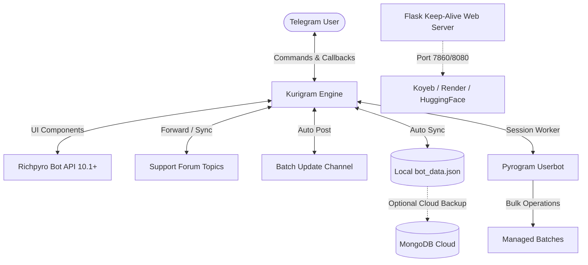

<div align="center">

# ⚡ Advanced Telegram Bot & Community Ecosystem Manager

[](https://python.org)
[](https://github.com/Telegram-Kurigram/Kurigram)
[-teal?style=for-the-badge)](https://github.com/devgaganin/richpyro)
[](https://mongodb.com)
[](https://flask.palletsprojects.com/)
[](https://docker.com)

**An enterprise-grade, state-of-the-art Telegram bot architecture engineered for managing massive educational & premium communities, multi-tier paid/free batch ecosystems, automated link provisioning, userbot content automation, and forum-based customer support.**

[Features](#-feature-highlights) • [Architecture](#-architecture-overview) • [Installation](#-quick-start--installation) • [Deployment](#-deployment-options) • [Commands Manual](#-commands--manual) • [Configuration](#-environment-variables)

---

</div>

## 🌟 Feature Highlights

```
┌────────────────────────────────────────────────────────────────────────┐
│                        TELEGRAM BOT ECOSYSTEM                          │
├──────────────────┬──────────────────┬──────────────────┬───────────────┤
│ 🔐 Smart Access  │ 💎 Economy Engine│ 🤖 Userbot Tools │ 🎫 2-Way Sync │
│ • 1-Time Invites │ • Referral System│ • SuperForwarder │ • Forum Topics│
│ • 3h Auto-Demo   │ • Coins & Wallet │ • Caption Editor │ • Reactions   │
│ • Free/Paid/Spec │ • Promo Vouchers │ • Anti-Leech     │ • Deletions   │
└──────────────────┴──────────────────┴──────────────────┴───────────────┘
```

### 1. 🔐 Multi-Tier Batch & Access Management
* **Three Dedicated Batch Tiers:**
  * 🆓 **Free Batches:** Generates unique, 1-time expiring join links (1-minute auto-expiry) to prevent link leakages and unauthorized sharing. Supports universal 1-coin unlock after 3 batches.
  * 💵 **Paid Batches:** Features pricing tags, screenshot payment submission, and an approval workflow (Permanent or Timed Demo) with automatic user notifications.
  * ✨ **Special Batches:** Gated batches unlocked exclusively using coins earned through the Referral Program.
* **Automated Demo Lifecycle:**
  * 3-hour automated trial timer.
  * Auto-kick cron scheduler removes users from demo channels once trial concludes.
  * Admins can extend demo time or generate instant demo invite links on demand.
* **Batch Update Channel Auto-Posting:**
  * Automatically inspects target batch channel profile picture (DP).
  * Generates high-conversion announcement cards with **Richpyro Primary (`ButtonStyle.PRIMARY`)** and **Success (`ButtonStyle.SUCCESS`)** styled buttons.
  * Auto-notifies all users who submitted requests for that specific batch once it goes live!

---

### 2. 💎 Referral & Coins Economy Engine
* **Automated Referral Tracking:** Unique invite links (`https://t.me/bot?start=ref_<uid>`) with 1-tap copy buttons and deep links for Telegram & WhatsApp.
* **Anti-Fraud Security:** Prevents self-referrals and duplicate credits.
* **Promo Voucher System:** Create time/usage-limited gift vouchers (`/genvoucher <CODE> <COINS> <USES>`) redeemable by users in the menu.
* **Global Leaderboard:** Live top-10 referral rankings with real-time coin balance tracking.
* **Bonus Claims:** Monthly bonus coin distribution for active community members.

---

### 3. 📋 Batch Demands & Admin Checklist System
* **User Demand Registration:** Users can request new study materials or courses directly from the interface.
* **Custom Acknowledgement Note:** Admins can set dynamic notes (`/setrequestnote`) displayed upon demand submission.
* **Visual Progress Tracker:** Admin terminal displays interactive checklist bars (e.g. `[████░░░░] 50%`) with pending vs uploaded tallies.
* **1-Tap Upload Notification:** When an admin marks a requested batch as uploaded (`☑`), the bot automatically blasts private DM notifications to all users who demanded that batch.

---

### 4. 🎫 Topic-Based Forum Support Ticket System
* **2-Way Forum Integration:** Forwards user direct messages into individual Telegram Forum Topics inside a private Staff Supergroup.
* **Live Reaction Sync:** Admin emoji reactions in the forum topic sync to the user's DM and vice-versa.
* **Live Deletion Sync:** When staff delete messages in the support topic, corresponding messages in the user's DM are purged in real time.
* **Full Media Support:** Handles voice notes, documents, screenshots, and videos seamlessly.

---

### 5. 🤖 Built-In Userbot Automation Suite
* **Super Forwarder (All-in-One):** Bulk-forwards media, files, and lectures between private/restricted channels with rate-limiting protection.
* **Advanced Caption Changer:** Scans channel message ranges (`min_id` to `max_id`) and applies regex/prefix/suffix edits without losing media files.
* **Anti-Leech Member Cleaner:** Scans channels and automatically purges members who left the mandatory channel or failed verification.
* **Session Login:** Interactive String Session management directly from the terminal.

---

### 6. 🎛️ Terminal Dashboard & Control Panels
* **Owner Terminal (`/owner`):**
  * **Security & Access Control:** Global Lockdown, Free Batch Lock, Paid Batch Lock, Maintenance Mode toggles.
  * **Database Operations:** Real-time JSON database export, MongoDB cloud synchronizer, user account reset, user lookup.
  * **Staff Management:** Promote/demote admins on the fly.
* **Admin Terminal (`/admin`):**
  * Interactive Batch Creation Wizard (Category, Access Level, Pricing, Channel ID).
  * Member Approvals Center (Demo & Permanent approvals).
  * Broadcast Engine with persistent pins and auto-deleting channel updates.

---

## 🏗️ Architecture Overview



---

## ⚙️ Environment Variables

Create a `.env` file in the root directory or configure them in your cloud provider's dashboard:

| Variable | Description | Required | Example |
|---|---|:---:|---|
| `TELEGRAM_BOT_TOKEN` | Bot API token obtained from [@BotFather](https://t.me/BotFather) | **Yes** | `7845123456:AAFd...` |
| `OWNER_ID` | Numeric Telegram user ID of the Bot Owner | **Yes** | `123456789` |
| `MANDATORY_CHANNEL_ID` | Telegram Channel ID for mandatory force-subscription | **Yes** | `-1001234567890` |
| `MANDATORY_CHANNEL_LINK` | Invite URL for the mandatory channel | **Yes** | `https://t.me/MyChannel` |
| `SUPPORT_GROUP_ID` | Supergroup ID with **Topics (Forums)** enabled | **Yes** | `-1009876543210` |
| `BATCH_UPDATE_CHANNEL_ID` | Channel ID where new batch posts are announced | No | `-1004304703943` |
| `BATCH_UPDATE_CHANNEL_LINK`| Public/Private link to your Batch Update Channel | No | `https://t.me/c/4304703943` |
| `LOG_CHANNEL_ID` | Channel ID for audit logs, demo expiries, and alerts | No | `-1005555555555` |
| `CONTACT_ADMIN_LINK` | Direct contact username or URL for manual inquiries | No | `https://t.me/YourUsername` |
| `MONGO_URL` | MongoDB connection URI for persistent cloud database sync | No | `mongodb+srv://...` |
| `DATA_FILE` | Path to JSON database file | No | `bot_data.json` |
| `PORT` | Web server port for keep-alive checks | No | `7860` |

> [!IMPORTANT]
> Channel IDs must be numeric and typically begin with `-100` (e.g., `-1001234567890`).

---

## 🚀 Quick Start & Installation

### Option 1: Local Setup

1. **Clone the repository:**
   ```bash
   git clone https://github.com/itsh4ro5/botupdate.git
   cd botupdate
   ```

2. **Create a virtual environment & install dependencies:**
   ```bash
   python -m venv venv
   # Linux/macOS:
   source venv/bin/activate
   # Windows:
   venv\Scripts\activate

   pip install -r requirements.txt
   ```

3. **Configure Environment:**
   Create a `.env` file or export your variables:
   ```bash
   cp .env.example .env # edit with your values
   ```

4. **Run the Bot:**
   ```bash
   python bot.py
   ```

---

### Option 2: Docker Container

```bash
# Build Docker image
docker build -t telegram-batch-bot .

# Run container with environment file
docker run -d \
  --name batch-bot \
  --restart unless-stopped \
  -v $(pwd)/data:/app/data \
  --env-file .env \
  -p 7860:7860 \
  telegram-batch-bot
```

---

## ☁️ Deployment Options

<details>
<summary><b>Deploying to Render / Koyeb</b></summary>

1. Fork or push this repository to GitHub.
2. In **Render** / **Koyeb**, create a new **Web Service**.
3. Choose **Docker** environment (or Python 3.10+ runtime).
4. Build Command: `pip install -r requirements.txt` (if using native Python).
5. Start Command: `python bot.py`
6. Add all required environment variables under the **Environment** tab.
7. *(Optional)* Add a Persistent Disk mounted at `/data` and set `DATA_FILE=/data/bot_data.json` to prevent data loss on restarts.
</details>

<details>
<summary><b>Deploying to Hugging Face Spaces</b></summary>

This repository includes Hugging Face Docker configuration headers.
1. Create a new Space with the **Docker** SDK.
2. Push this repo to your Space repository.
3. Add your Bot Token and Owner ID in **Settings > Variables and secrets**.
4. The bot will automatically boot and expose its health endpoint on port `7860`.
</details>

---

## 📖 Commands & Manual

### 👑 Owner Terminal Commands
| Command | Arguments | Description |
|---|---|---|
| `/owner` | None | Open the master interactive control terminal |
| `/addadmin` | `<user_id>` | Promote a user to Admin dynamically |
| `/removeadmin` | `<user_id>` | Demote an Admin back to standard user |
| `/backup` | None | Instant export & download of JSON database |
| `/sync` | None | Force immediate cloud sync with MongoDB |
| `/allusers` | None | Generate complete registered users CSV/dump |
| `/genvoucher` | `<CODE> <COINS> <USES>` | Mint custom promo coin vouchers |
| `/vouchers` | None | View all active and claimed vouchers |
| `/setprice` | `<batch_id> <price>` | Update pricing tag for a paid course |
| `/setwelcome` | `<batch_id> <text>` | Set custom welcome DM for batch joiners |
| `/setrequestnote` | `<text>` | Update batch demand acknowledgement note |
| `/settestbot` | `<link>` | Set practice test bot link |
| `/ban` / `/unban` | `<user_id>` | Globally blacklist or whitelist a user |
| `/resetuser` | `<user_id>` | Reset a user's join history and demo logs |

---

### 🛡️ Admin Commands
| Command | Arguments | Description |
|---|---|---|
| `/admin` | None | Open Admin dashboard & approvals center |
| `/addbatch` | None | Launch interactive Batch Addition Wizard |
| `/batchrequests` | None | Open Batch Demands Checklist & Progress Tracker |
| `/batchstats` | `<batch_id>` | View member count and engagement stats |
| `/check` | `<user_id>` | Check a user's force-sub & access status |
| `/link` | `<user_id>` | Link a support topic manually to a user ID |
| `/cancel` | None | Abort any active input state or wizard |

---

### 👤 User Commands
| Command | Description |
|---|---|
| `/start` | Open personalized user dashboard and batch catalog |
| `/batch` | View joined batches and access direct study portals |
| `/id` | Check your Telegram User ID & current chat details |

---

## 🔒 Bot Permissions Checklist

Ensure the bot has the following administrator permissions:

| Context | Required Permissions | Purpose |
|---|---|---|
| **Mandatory Channel** | `Invite Users via Link` | Verify membership & check anti-leech status |
| **All Batch Channels** | `Invite Users`, `Manage Voice Chats / Messages`, `Ban Users` | Generate 1-time links & auto-kick expired demos |
| **Support Supergroup** | `Manage Topics`, `Delete Messages`, `Pin Messages` | Create user ticket topics & bidirectional sync |
| **Batch Update Channel** | `Post Messages`, `Edit Messages` | Publish rich announcement cards with styled buttons |

---

## 📄 License & Credits

Distributed under the MIT License. Built and maintained with passion by **[IT'S H4R](https://github.com/itsh4ro5)**.
