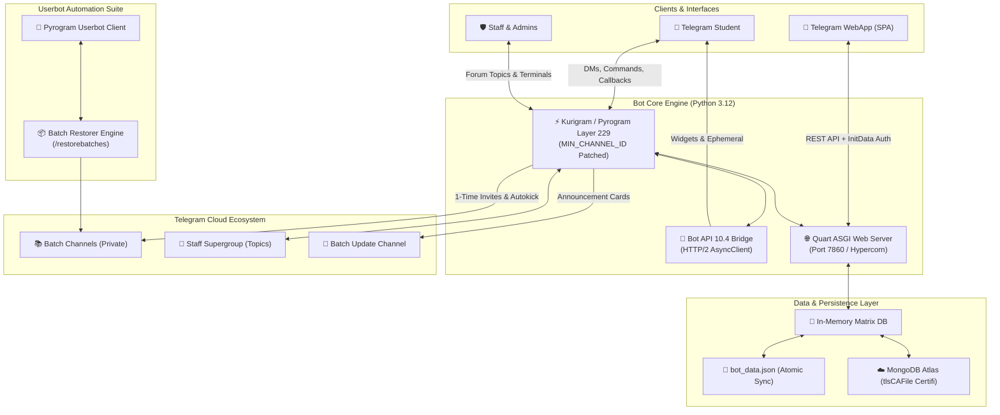

<div align="center">

# ⚡ H4R Telegram Bot & Student Education Ecosystem

[](https://python.org)
[-0088cc?style=for-the-badge&logo=telegram&logoColor=white)](https://core.telegram.org/bots/api)
[](https://github.com/Telegram-Kurigram/Kurigram)
[](https://pgjones.gitlab.io/quart/)
[](https://mongodb.com)
[](https://docker.com)
[](https://huggingface.co/spaces)

**An enterprise-grade, state-of-the-art Telegram Bot & Student Community Ecosystem. Engineered with a Telegram Bot API 10.4 Hybrid Bridge, Telegram WebApp (TWA) Student Portal, Multi-Tier Batch Provisioning with 1-Time Expiring Links, 2-Way Forum Support Ticket Sync, Userbot Batch Recovery Suite, and Exam Preparation Radar.**

[🌟 Features](#-feature-highlights) • [🏛️ Architecture](#-system-architecture) • [📱 WebApp Portal](#-student-webapp-portal) • [🚀 Quick Start](#-quick-start--installation) • [☁️ Deployment](#-deployment-options) • [📖 Commands](#-commands--manual) • [🔌 REST APIs](#-rest-api-endpoints) • [⚙️ Configuration](#-environment-variables)

---

</div>

## 🌟 Feature Highlights

```
┌────────────────────────────────────────────────────────────────────────────────────────┐
│                                H4R BOT & WEB ECOSYSTEM                                 │
├─────────────────────┬─────────────────────┬─────────────────────┬──────────────────────┤
│ 🚀 Bot API 10.4     │ 📱 Student WebApp   │ 🔐 Batch Manager    │ 🤖 Userbot & Recovery│
│ • In-Chat Widgets   │ • Exam Vacancy Radar│ • 1-Time Auto-Links │ • /restorebatches    │
│ • Ephemeral Replies │ • 2026 Countdown    │ • 3-Hour Auto-Demo  │ • Super Forwarder    │
│ • Topic Deep-Links  │ • Mock Test Arena   │ • Demand Checklist  │ • Caption Editor     │
│ • Giveaway Ticker   │ • Study Tasks & Stre│ • Delete/Clean Mode │ • Anti-Leech Guard   │
└─────────────────────┴─────────────────────┴─────────────────────┴──────────────────────┘
```

### 1. 🚀 Telegram Bot API 10.4 Hybrid Bridge (`bot_api_bridge.py`)
Powered by a persistent, pooled HTTP/2 asynchronous client (`httpx.AsyncClient`) that runs side-by-side with Pyrogram/Kurigram MTProto:
* **In-Chat HTML Widgets (`sendWidget`, `editMessageWidgetData`):** Sends interactive mini-apps and rich HTML widget cards directly into private chats with built-in `protected_content` (anti-piracy forward prevention).
* **Ephemeral Messages:** Dispatches instant auto-vanishing notifications and answers linked directly to `callback_query_id` using `ephemeral_message_parameters`, preventing chat spam.
* **Topic Deep-Linking:** Automatically generates standard universal forum thread links (`https://t.me/<bot_username>/<thread_id>`).
* **Live Giveaway Claims Ticker:** Interactive giveaway cards featuring visual animated slot progress bars (`[██████░░░░] 60%`), real-time claimed slots counters, and live claimer modal views.
* **Redesigned Batch Demands Console:**
  * Clean 1-button-per-row full-width layout displaying up to 30 characters without text truncation.
  * Student requester names and `@usernames` rendered directly in the message body.
  * **Dedicated 1-Tap Delete & Cleanup Mode (`🗑️ Delete / Clean`):** Admins can delete spam/bogus requests individually or clean all uploaded batches with a single click.

---

### 2. 📱 Modern Student WebApp & Study Companion (`/webapp`, `/app`, `/store`)
A mobile-optimized, glassmorphism single-page application built on top of the Telegram WebApp SDK (`Telegram.WebApp`):
* **Student Telemetry & Access Hub:** Displays verified Telegram user profile, coin balance, invite counts, and instant 1-tap batch study portals.
* **🎯 Exam Vacancy Radar:** Real-time tracking of active national exams (UPSC CSE, SSC CGL/CHSL, RRB JE/NTPC, SBI/IBPS, NEET UG, NDA/CDS, CTET) with vacancies, eligibility, last dates, and direct official apply links.
* **⏳ 2026 Competitive Exam Countdown Clocks:** Live countdown timers (Days : Hours : Mins : Secs) to target exam dates.
* **📰 Daily Current Affairs Digest:** Curated high-yield current affairs snippets across National Governance, Science & Tech, Defence, and Economy.
* **📝 Multi-Subject Mock Test Arena:**
  * High-yield mock tests with real-time exam countdown timer.
  * TCS-style marking scheme (+2.0 positive mark, -0.50 negative marking penalty).
  * Instant score breakdown, accuracy percentage, and detailed answer explanations.
* **✅ Interactive Study Tasks Checklist:** Daily, One-time, and Custom Date study goals with local persistence and completion streaks.
* **⏱️ Pomodoro Study Timer & Streaks:** Tracks active study minutes and completed sessions with gamified daily study streak rewards.
* **🏆 Study Leaderboard:** Real-time rankings showcasing top learners by study minutes, sessions, and streaks.
* **🛍️ Recommended Prep Resources:** Handpicked topper-recommended books and mock test discount links.
* **🛡️ Role-Based Maintenance Mode:**
  * Full lockdown screen for regular students displaying a high-tech animated "Under Maintenance" portal with support contact.
  * Automatic bypass for Owner, Admins, and Whitelisted Testers (managed via Telegram Chat IDs).

---

### 3. 🔐 Multi-Tier Batch Provisioning & Access Lifecycle
* **Three Dedicated Batch Tiers:**
  * 🆓 **Free Batches:** Generates unique, 1-time expiring join links (60-second validity) to prevent link forwarding and unauthorized leaks. Includes universal 1-coin unlock after 3 batches.
  * 💵 **Paid Batches:** Features dynamic price tags, QR screenshot payment proof uploads, and an approval center (Permanent or Timed Demo) with automatic user notifications.
  * ✨ **Special Batches:** Unlocked exclusively through study coins earned via the Referral Program.
* **Automated 3-Hour Demo Lifecycle:**
  * Background cron scheduler tracks demo expiry times.
  * Automatically removes users from batch channels when their trial concludes and logs audit records to the log channel.
  * Admins can extend demo duration or grant permanent access anytime.
* **Batch Update Channel Auto-Posting:**
  * Automatically downloads and caches the target batch channel's profile avatar.
  * Publishes high-conversion announcement cards with **Richpyro Primary** and **Success** styled action buttons.
  * Automatically notifies all users who demanded that batch the moment it goes live!

---

### 4. 🎫 Topic-Based 2-Way Forum Support Ticket Dispatcher
* **Bidirectional Sync:** Seamlessly converts user direct messages into isolated Telegram Forum Topics inside a private Staff Supergroup.
* **Reaction Sync:** Staff reactions inside a topic sync directly to the student's DM and vice-versa.
* **Deletion Sync:** Deleting a staff response in the support topic purges the corresponding message from the student's DM in real time.
* **Rich Media Handling:** Supports voice notes, PDFs, code files, screenshots, and video messages.

---

### 5. 🤖 Userbot Content Automation Suite & Disaster Recovery
* **📦 Userbot Batch Restorer (`/restorebatches` / `restore_batches.py`):**
  * Restores missing batches from JSON/MongoDB backups.
  * Userbot joins private channels, adds the bot, promotes it to full administrator, extracts invite links, and restores original categories.
  * **100% Non-Destructive:** Preserves all active batches and existing database settings.
* **⚡ Super Forwarder:** Bulk-forwards media, lectures, and files between restricted channels with flood-wait protection.
* **✏️ Advanced Caption Editor:** Scans channel message IDs (`min_id` to `max_id`) and applies regex/prefix/suffix modifications without re-uploading media.
* **🛡️ Anti-Leech Cleaner:** Automatically scans batch channels and removes members who leave the mandatory force-sub channel.

---

### 6. 🎛️ Dual Control Terminals (In-Bot + Web Portal)
* **👑 Owner Terminal (`/owner` and `/owner` web):**
  * Toggle Maintenance Mode, Global Lockdown, Free Batch Lock, and Paid Batch Lock.
  * Whitelist or remove WebApp Testers by Telegram Chat ID.
  * Download instant database JSON backups and trigger MongoDB Atlas cloud synchronization.
  * Broadcast engine with optional pinning and auto-delete timers.
* **🛡️ Admin Terminal (`/admin` and `/admin` web):**
  * Interactive Batch Addition Wizard (Category, Access Level, Price, Channel ID).
  * Member Approvals Center (Demo & Permanent approvals).
  * Vacancy & Current Affairs Manager.
  * User lookup and coins gifting.

---

## 🏛️ System Architecture



---

## ⚙️ Environment Variables

Configure these variables in your `.env` file or cloud dashboard:

| Variable | Required | Default | Description |
|---|:---:|:---:|---|
| `TELEGRAM_BOT_TOKEN` | **Yes** | — | Bot token obtained from [@BotFather](https://t.me/BotFather) |
| `OWNER_ID` | **Yes** | `0` | Numeric Telegram User ID of the primary owner |
| `API_ID` | Conditional | `0` | Telegram API ID from [my.telegram.org](https://my.telegram.org) (for Userbot/Restorer) |
| `API_HASH` | Conditional | `""` | Telegram API Hash from [my.telegram.org](https://my.telegram.org) |
| `MANDATORY_CHANNEL_ID` | **Yes** | `0` | Force-sub channel ID (e.g. `-1001234567890`) |
| `MANDATORY_CHANNEL_LINK` | **Yes** | `""` | Invite link for the mandatory channel |
| `SUPPORT_GROUP_ID` | **Yes** | `0` | Supergroup ID with **Topics (Forums)** enabled |
| `BATCH_UPDATE_CHANNEL_ID` | No | `-1004304703943` | Channel ID for live batch announcements |
| `BATCH_UPDATE_CHANNEL_LINK`| No | `""` | Link to the Batch Update Channel |
| `LOG_CHANNEL_ID` | No | `0` | Channel ID for audit trails, demo expiries, and alerts |
| `MONGO_URL` | No | `None` | MongoDB Atlas URI for persistent cloud database sync |
| `DATA_FILE` | No | `bot_data.json` | Path to the local JSON database file |
| `PORT` | No | `7860` | Web server port (Default: `7860` for Hugging Face) |
| `WEB_APP_URL` | No | Auto | Public URL of the WebApp (e.g. `https://itsh4r01-user-manager.hf.space`) |
| `WEB_PASSWORD` | No | `OWNER_ID` | Password to access `/owner` and `/admin` web dashboards |
| `SESSION_STRING` | No | `""` | Pyrogram String Session for Userbot features |

> [!IMPORTANT]
> Channel and Group IDs must be integers starting with `-100` (e.g., `-1001928374650`).

---

## 🚀 Quick Start & Installation

### Option 1: Native Python Setup

1. **Clone the repository:**
   ```bash
   git clone https://github.com/itsh4ro5/botupdate.git
   cd botupdate
   ```

2. **Set up a virtual environment:**
   ```bash
   python -m venv venv

   # Linux / macOS:
   source venv/bin/activate

   # Windows PowerShell:
   venv\Scripts\Activate.ps1
   ```

3. **Install dependencies:**
   ```bash
   pip install --upgrade pip
   pip install -r requirements.txt
   ```

4. **Configure environment:**
   ```bash
   cp .env.example .env
   # Edit .env with your credentials
   ```

5. **Start the engine:**
   ```bash
   python bot.py
   ```

---

### Option 2: Docker Container

```bash
# Build the Docker image
docker build -t h4r-telegram-bot .

# Run the container
docker run -d \
  --name h4r-bot \
  --restart always \
  -p 7860:7860 \
  --env-file .env \
  -v $(pwd)/data:/app/data \
  h4r-telegram-bot
```

---

## ☁️ Deployment Options

<details>
<summary><b>1. Deploying to Hugging Face Spaces (Recommended)</b></summary>

This repository includes native Hugging Face Spaces Docker headers.
1. Create a new Space on [Hugging Face](https://huggingface.co/new-space).
2. Choose **Docker** as the Space SDK (Blank template).
3. Connect your GitHub repository or push directly to the HF Space git remote.
4. Go to **Settings > Variables and secrets** in your Space:
   * Add `TELEGRAM_BOT_TOKEN`, `OWNER_ID`, `MANDATORY_CHANNEL_ID`, `MANDATORY_CHANNEL_LINK`, `SUPPORT_GROUP_ID`, `MONGO_URL`, etc.
5. The container boots automatically and opens the health endpoint on port `7860`.
</details>

<details>
<summary><b>2. Deploying to Render / Koyeb / Railway</b></summary>

1. Connect your GitHub repository to **Render** or **Koyeb**.
2. Create a new **Web Service**.
3. Set the Environment to **Docker** (or Python 3.10+).
4. If using native Python:
   * Build Command: `pip install -r requirements.txt`
   * Start Command: `python bot.py`
5. Supply all environment variables under the **Environment** tab.
6. *(Recommended)* Add a persistent disk mounted at `/app/data` and set `DATA_FILE=/app/data/bot_data.json`.
</details>

<details>
<summary><b>3. Deploying to Ubuntu VPS with Systemd</b></summary>

Create a systemd service file `/etc/systemd/system/h4rbot.service`:
```ini
[Unit]
Description=H4R Telegram Bot & Web Ecosystem
After=network.target

[Service]
Type=simple
User=root
WorkingDirectory=/root/botupdate
ExecStart=/root/botupdate/venv/bin/python bot.py
Restart=always
RestartSec=5
EnvironmentFile=/root/botupdate/.env

[Install]
WantedBy=multi-user.target
```
Enable and start the service:
```bash
sudo systemctl daemon-reload
sudo systemctl enable h4rbot
sudo systemctl start h4rbot
sudo systemctl status h4rbot
```
</details>

---

## 📖 Commands & Manual

### 👑 Owner Terminal Commands
| Command | Arguments | Description |
|---|---|---|
| `/owner` | None | Opens the interactive Master Terminal with toggles & system stats |
| `/addadmin` | `<user_id>` | Dynamically promotes a user to Admin |
| `/removeadmin` | `<user_id>` | Demotes an Admin to standard user |
| `/backup` | None | Instant export & document download of `bot_data.json` |
| `/sync` | None | Forces immediate synchronization with MongoDB Atlas |
| `/restorebatches` | None (reply to file) | Launches Userbot automated batch recovery from backup JSON |
| `/allusers` | None | Generates a complete registered user dump/CSV |
| `/genvoucher` | `<CODE> <COINS> <USES>` | Mints custom study coin gift vouchers |
| `/vouchers` | None | Displays active, depleted, and claimed promo vouchers |
| `/setprice` | `<batch_id> <price>` | Sets or updates pricing for paid batches |
| `/setwelcome` | `<batch_id> <text>` | Configures custom welcome DM for batch joiners |
| `/setrequestnote` | `<text>` | Sets dynamic acknowledgement note for batch demands |
| `/settestbot` | `<link>` | Sets practice test bot link |
| `/ban` / `/unban` | `<user_id>` | Blacklists or whitelists a user from the bot |
| `/resetuser` | `<user_id>` | Clears a user's join history and trial demo records |

---

### 🛡️ Admin Commands
| Command | Arguments | Description |
|---|---|---|
| `/admin` | None | Opens Admin Dashboard & Approvals Center |
| `/addbatch` | None | Launches the interactive step-by-step Batch Creation Wizard |
| `/batchrequests` | None | Opens redesigned Batch Demands Console with 1-tap delete mode |
| `/batchstats` | `<batch_id>` | Displays member counts and active user statistics |
| `/check` | `<user_id>` | Inspects user force-subscription and batch access rights |
| `/link` | `<user_id>` | Manually binds a support topic to a specific Telegram user ID |
| `/cancel` | None | Cancels any ongoing state wizard or input session |

---

### 👤 Student / User Commands
| Command | Description |
|---|---|
| `/start` | Opens personalized student dashboard, batch catalog, and WebApp launcher |
| `/batch` | Displays all enrolled batches and direct study channels |
| `/id` | Displays your Telegram User ID, chat ID, and topic info |

---

## 🔌 REST API Endpoints

The built-in Quart ASGI web server exposes high-performance REST APIs:

| Endpoint | Method | Authentication | Description |
|---|:---:|:---:|---|
| `/health` | `GET` | Public | Service health status, user counts, and batch totals |
| `/webapp` or `/app` | `GET` | Public / Role Check | Main Student WebApp Portal (supports maintenance mode) |
| `/api/twa/session` | `POST` | `Telegram.WebApp.initData` | Validates WebApp session and returns student telemetry |
| `/api/vacancies` | `GET` | Public | Returns active competitive exam radar listings |
| `/api/current-affairs` | `GET` | Public | Returns daily high-yield exam current affairs |
| `/api/study/complete-session` | `POST` | TWA Session | Logs completed Pomodoro study minutes |
| `/api/study/complete-quiz` | `POST` | TWA Session | Records mock test quiz results and accuracy |
| `/api/study/claim-streak` | `POST` | TWA Session | Claims daily study streak reward coins |
| `/api/study/tasks` | `GET` / `POST`| TWA Session | Retrieves or saves personal study tasks |
| `/api/request-batch` | `POST` | TWA Session | Submits student batch demand requests |
| `/api/redeem` | `POST` | TWA Session | Redeems promo coin vouchers |
| `/api/owner/testers/add` | `POST` | Admin Session | Whitelists tester Chat ID for maintenance bypass |
| `/api/owner/testers/delete`| `POST` | Admin Session | Removes whitelisted tester |
| `/api/owner/backup/download`| `GET` | Owner Session | Downloads encrypted/raw database backup |

---

## 🔒 Bot Permissions Checklist

Ensure the bot is granted these permissions across the ecosystem:

| Channel / Group | Required Permissions | Purpose |
|---|---|---|
| **Mandatory Channel** | `Invite Users via Link` | Verifies force-sub membership and anti-leech status |
| **All Batch Channels** | `Invite Users`, `Manage Messages`, `Ban Users` | Generates 1-time expiring links & auto-kicks expired trials |
| **Support Supergroup** | `Manage Topics`, `Delete Messages`, `Pin Messages` | Creates student forum topics and mirrors reactions/deletions |
| **Batch Update Channel** | `Post Messages`, `Edit Messages` | Publishes rich announcement cards with primary/success buttons |

---

## 📄 License & Credits

Distributed under the **MIT License**. Engineered and maintained with passion by **[IT'S H4R](https://github.com/itsh4ro5)**.
